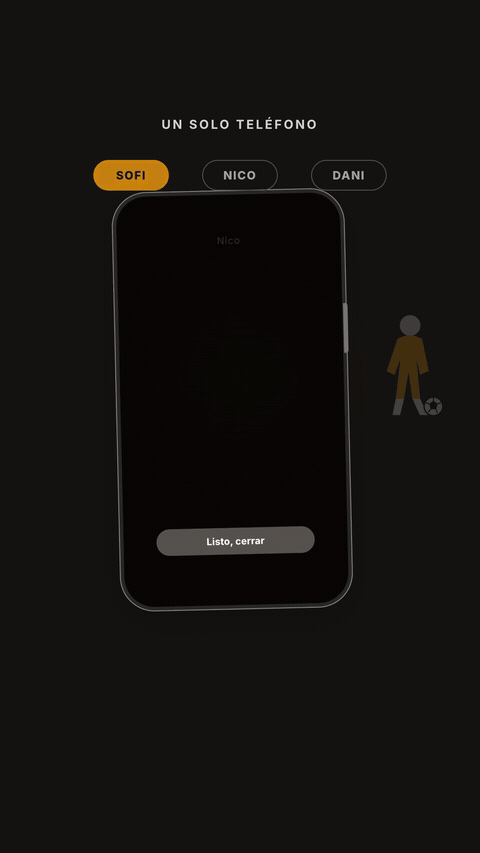

# El Impostor

A social deduction party game. Everyone is told the same secret word — except
the impostor, who has to bluff through the conversation without knowing it.

Three or more people, **one phone** that gets passed around. No installs, no
accounts, no moderator.

<p align="center">
  
</p>

> Open source under the MIT license. Runs with **zero API keys** — bring your
> own only if you want the extras.

## Status

Working and playable, but **not currently deployed**: the game used to run on
Railway and the project was removed. Run it yourself with one command, or read
[Deploying](#deploying).

## Run it

```bash
git clone https://github.com/LilMark0o/impostor.git && cd impostor
git clone https://github.com/LilMark0o/impostor-api.git api
git clone https://github.com/LilMark0o/impostor-web.git web
docker compose up --build
```

Open <http://localhost:5173>. That's it.

No Docker? Run the two halves by hand — see
[`impostor-api`](https://github.com/LilMark0o/impostor-api) and
[`impostor-web`](https://github.com/LilMark0o/impostor-web). It's three
commands each.

## Bring your own keys

The game ships with its content: 34 categories, three difficulty tiers and 319
curated hints for the impostor, all as plain Python in
[`app/config.py`](https://github.com/LilMark0o/impostor-api/blob/main/app/config.py).
A round never depends on a network
call.

Optional keys, each unlocking one extra:

| Key | Unlocks | Needed to play? |
|---|---|---|
| `OPENAI_API_KEY` *or* `OPENROUTER_API_KEY` | Validate custom categories, generate words and hints outside the shipped pools | No |
| `GOOGLE_CLIENT_ID` + `GOOGLE_CLIENT_SECRET` | Google login, saved history | No |
| `TELEGRAM_TOKEN` | Legacy flow that DMs each player their word | No |
| `DATABASE_URL` | Postgres instead of local SQLite | No |
| `JWT_SECRET_KEY` | Signing auth tokens | Yes in production, no locally |

LLM failures are swallowed on purpose: the static pools take over, so a bad
key costs you a feature, never a round. Full table in
[`api/.env.example`](https://github.com/LilMark0o/impostor-api/blob/main/.env.example).

## How a round works

1. Add at least three players.
2. Pick a mode — **clásico** (one impostor), **caos** (a random number),
   **aliados** (two impostors who know each other), **espejo** (the impostor
   gets a different word from the same category), **infiltrados**, or random.
3. Choose difficulty (fácil / difícil / brutal) and categories.
4. Pass the phone: each player taps their name and flips their card in private.

The impostor sees that they are the impostor plus a subtle hint, never the
word. Everyone else sees the word.

## Structure

```
impostor/
├── api/            FastAPI + SQLAlchemy, SQLite or Postgres
├── web/            React 18 + Vite + TypeScript, Tailwind, shadcn/ui
├── docker-compose.yml
├── brag-output/    promo video (local only, git-ignored)
└── LICENSE
```

`api` and `web` are separate repositories, kept side by side so each one can be
deployed and versioned on its own. This repo holds the glue: compose file,
license and the shared story.

### Content

`api/app/config.py` holds `WORD_POOLS` (category → easy/hard/brutal words),
`WORD_HINTS` (a one-word nudge per word, for the impostor) and
`CATEGORY_GROUPS` (what the app displays). Adding a category is a few lines;
tests keep the content honest: every hint belongs to a real word, no hint
leaks its word, and every hint is a single word.

Football categories name a year plus a winner (`2022 Argentina`,
`1989 Milan`, `2018 Harry Kane`), so the pool doubles as a bit of trivia.

## Deploying

The stack is two containers and a database. Free-tier friendly split:

| Piece | Safe bet | Notes |
|---|---|---|
| `web` | Cloudflare Pages, Netlify, Vercel | Static, no cold start |
| `api` | Fly.io, Render, Koyeb | Free tiers sleep: 30-60 s first request |
| database | Neon, Supabase | Or SQLite on a volume for a single instance |

Set `JWT_SECRET_KEY`, point `DATABASE_URL` at Postgres, and build the web app
with `VITE_API_URL` set to the public API URL. Railway works too, and both
repos still carry a `railway.json`.

## Demos and ads

Product-demo videos are built with [demo-forge](https://github.com/LilMark0o/demo-forge) (Playwright
screen recordings). The short vertical promo lives in `brag-output/`, built
with HyperFrames — read `brag-output/brag-plan.md` before touching it. Music
attribution is required (CC BY 4.0); see `brag-output/share-copy.txt`.

## License

MIT — see [LICENSE](LICENSE).
